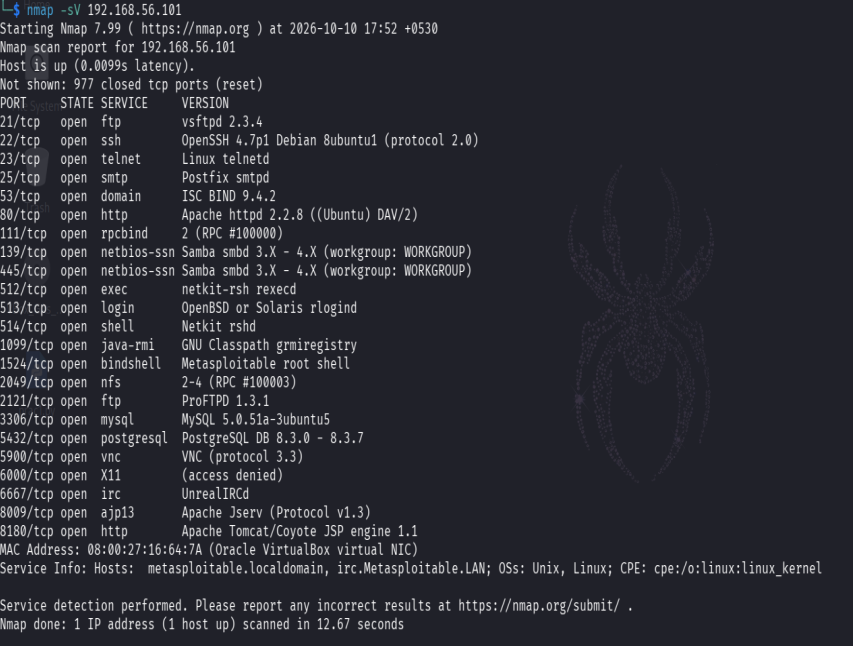

# Network Scanning with Nmap

## Objective
Identify a lab host's reachable TCP ports and collect service/version hints to support an initial attack-surface inventory.

## Concepts
Nmap sends probes and interprets responses. `open`, `closed`, and `filtered` describe the scanner's view of a port at scan time. Service/version detection provides clues, not definitive proof that a vulnerability exists.

## Lab environment and scope
- Tool: Nmap.
- Target shown in evidence: `192.168.56.101`, a private-address lab host.
- Only scan systems you own or are explicitly authorised to test.

## Procedure
1. Start the approved target VM and confirm its lab network address from the VM/network settings.
2. From the authorised scanning machine, verify basic reachability using the lab's normal connectivity check.
3. Run a basic TCP scan against the confirmed lab IP: `nmap <LAB_TARGET_IP>`.
4. To request service/version fingerprints on the same authorised target, run: `nmap -sV <LAB_TARGET_IP>`.
5. Wait for the scan to finish; save the terminal output or export it to a report file for reproducibility.
6. For each reported port, record the port number, transport, service label, and any version string shown.
7. Verify important results with service configuration or a second approved method before calling them vulnerabilities.
8. Stop scanning when the approved scope is complete.

## Observed result
The screenshot shows a service/version scan against `192.168.56.101`. Nmap reported the host as up, multiple open TCP services (including FTP, SSH, Telnet, SMTP, DNS, HTTP, SMB, and database-related services), and 977 closed TCP ports in the displayed scan. The screenshot is evidence of discovery output; exact service versions should be taken from the full terminal output, not inferred from the summary.

## Evidence

## Interpretation and limitations
Open services increase the reachable attack surface, but an open port alone is not a vulnerability. Service fingerprints can be inaccurate or incomplete, and the result is a point-in-time view. The screenshot contains lab network identifiers; this portfolio copy should be used only if you are comfortable making those lab identifiers public.

## Defensive recommendations
Disable unneeded services, restrict management protocols to trusted networks, patch exposed services, and compare the approved port inventory with actual scan results.

## Reference
[Nmap Reference Guide](https://nmap.org/book/man.html)
