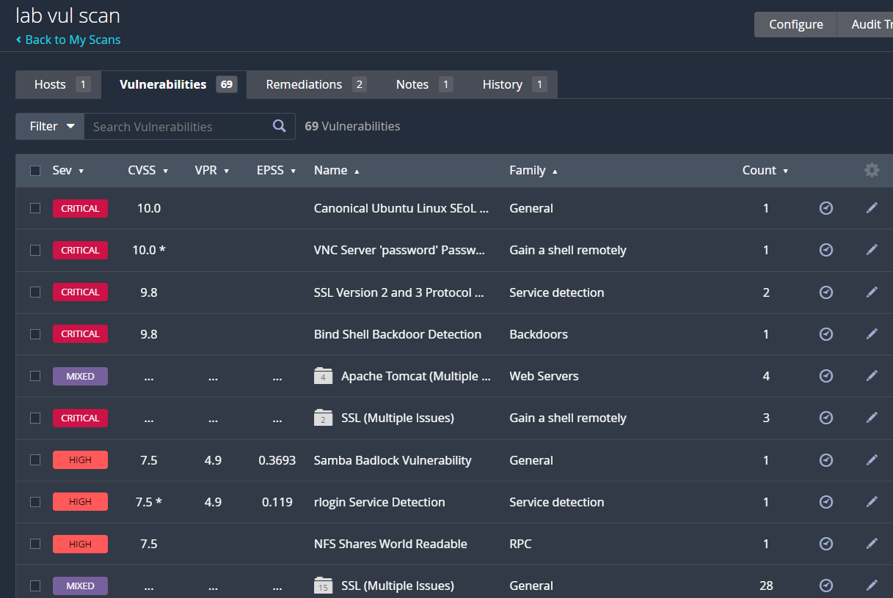

# Vulnerability Assessment with Nessus

## Objective
Run a vulnerability scan against an authorised lab host, group scanner findings by severity, and identify which findings require manual validation.

## Concepts
A vulnerability scanner compares observed services and responses with plugin checks and known issue patterns. Severity is useful for triage, but it is not proof of exploitability or business impact on its own.

## Lab environment and scope
- Tool: Tenable Nessus.
- Screenshot scan name: `lab vul scan`.
- Screenshot reports one host and 69 findings, with visible Critical and High severity entries.
- The screenshot does not expose enough detail to independently validate individual findings.

## Procedure
1. Start Nessus and sign in to its local web interface.
2. Open **Scans** and choose **New Scan**.
3. Select **Basic Network Scan** for a general assessment of an authorised lab host.
4. Give the scan a clear name and enter only the approved target IP or hostname.
5. Review the target and scan settings before saving; add credentials only when an authorised credentialed assessment is explicitly required.
6. Save the scan and select **Launch**.
7. Wait until the scan completes, then open the results page.
8. Review findings by severity, starting with Critical and High. Open each important finding to record its plugin name, affected host/port, evidence, confidence, and remediation.
9. Distinguish confirmed facts from scanner hypotheses. Validate important findings with safe configuration checks or the system owner.
10. After remediation, rerun the scan and compare the results to confirm whether the finding remains.

## Observed result
The screenshot shows a completed-looking scan summary named `lab vul scan`, one host, and 69 findings. Visible examples include scanner entries relating to Ubuntu Linux, VNC password configuration, SSL protocol issues, Samba Badlock, rlogin, and an NFS world-readable share. Because the screenshot shows a summary and truncated rows, these are recorded as **scanner-reported** items, not independently confirmed vulnerabilities.

## Evidence

## Interpretation and limitations
The number of findings is not a direct measure of risk. False positives, duplicate findings, missing credentials, and incomplete coverage can affect results. No claim is made that every displayed issue was exploitable.

## Remediation priorities
Prioritise internet- or network-exposed Critical/High findings after validation; remove legacy services such as rlogin where unnecessary; restrict file shares and remote administration; patch affected software; and rescan after fixes.

## Reference
[Tenable Nessus Documentation](https://docs.tenable.com/nessus/)
