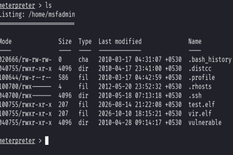

# Post-Exploitation Concepts with Meterpreter

## Objective
Record basic file and directory enumeration observed in an authorised lab session.

## Evidence

## Observation
The screenshot shows a Meterpreter prompt and a directory listing for `/home/msfadmin`, including filenames and file permissions. It demonstrates basic directory enumeration in the lab.

## Analysis and limitations
The screenshot supports the observation that a Meterpreter session was available and a directory listing was displayed. It does not establish the full privileges, persistence, or broader impact of the session.

## Defensive recommendations
Apply least privilege, monitor unusual remote sessions and process activity, segment networks, and investigate unexpected access to user directories.

## Reference
Metasploit Documentation: https://docs.metasploit.com/

