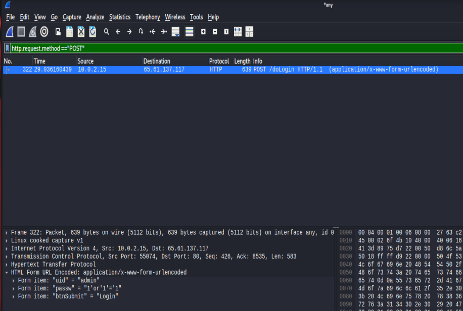

# Network Traffic Analysis with Wireshark

## Objective
Inspect an HTTP POST request in a training capture and understand what packet contents can reveal.

## Evidence

## Observation
The screenshot shows a packet filtered as an HTTP POST request, with form fields visible in the packet details. The displayed destination is a public IP address, and the form data includes a password-like value.

## Safety and publication note
**Do not publish this original screenshot as-is.** It exposes form fields and a password-like value, and it appears to involve traffic to a public destination. Before sharing any evidence, confirm the capture came from an authorised training environment and redact the destination IP and all sensitive field values. If this was not your own or authorised traffic, do not publish or further inspect its contents.

## Analysis
HTTP POST traffic is not necessarily encrypted. This screenshot illustrates that form data can be visible in a packet capture, but it does not establish the legitimacy of the destination or the broader context of the traffic.

## Recommendations
Use HTTPS/TLS, avoid sending secrets over cleartext HTTP, and capture only traffic you are authorised to inspect.

## Reference
Wireshark User's Guide: https://www.wireshark.org/docs/wsug_html_chunked/

