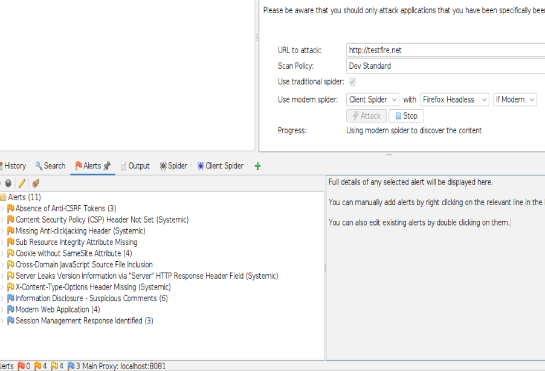

# Web Application Scanning with OWASP ZAP

## Objective
Review alerts from an automated web application scan and distinguish scanner output from confirmed security defects.

## Concepts
OWASP ZAP can spider a web application and run passive or active checks. Alert risk and confidence should be reviewed alongside the evidence and the target's scope. A summary count alone does not prove exploitability.

## Lab environment and scope
The screenshot shows a ZAP scan targeting `http://testfire.net` with a Dev Standard policy and 11 alerts. Use only targets explicitly permitted for testing; public availability does not itself grant permission. The screenshot does not show details for individual alerts.

## Procedure
1. Confirm that the application is an approved training target and that the planned scan type is permitted.
2. Open OWASP ZAP and configure the intended target in the scan interface.
3. Select a scan policy appropriate to the authorised scope. Do not run active tests against an unapproved production site.
4. Start the scan and wait for the spider/scanner activity to finish.
5. Open the **Alerts** tab and group findings by risk and confidence.
6. Open each important alert and record its URL, parameter or response evidence, risk, confidence, and recommended fix.
7. Validate findings using safe, in-scope checks. Treat informational alerts and missing-header observations differently from demonstrated injection or access-control flaws.
8. Export only a sanitised report, avoiding cookies, tokens, personal data, and unnecessary request/response bodies.
9. Report findings to the application owner and rescan after fixes where authorised.

## Observed result
The screenshot shows 11 alerts. Visible categories include absent anti-CSRF tokens, missing Content Security Policy and anti-clickjacking headers, a missing Sub Resource Integrity attribute, cookie SameSite concerns, cross-domain JavaScript source inclusion, server-version disclosure, missing X-Content-Type-Options, suspicious comments, a modern web application alert, and session-management-related alerts. These are recorded as scanner alerts, not confirmed exploitable vulnerabilities.

## Evidence

## Analysis and recommendations
Review each alert's evidence and confidence before assigning severity. Add security headers where suitable, configure cookies appropriately, minimise server-version disclosure, and investigate session-management findings based on the application's design.

## Reference
[OWASP ZAP Documentation](https://www.zaproxy.org/docs/)
